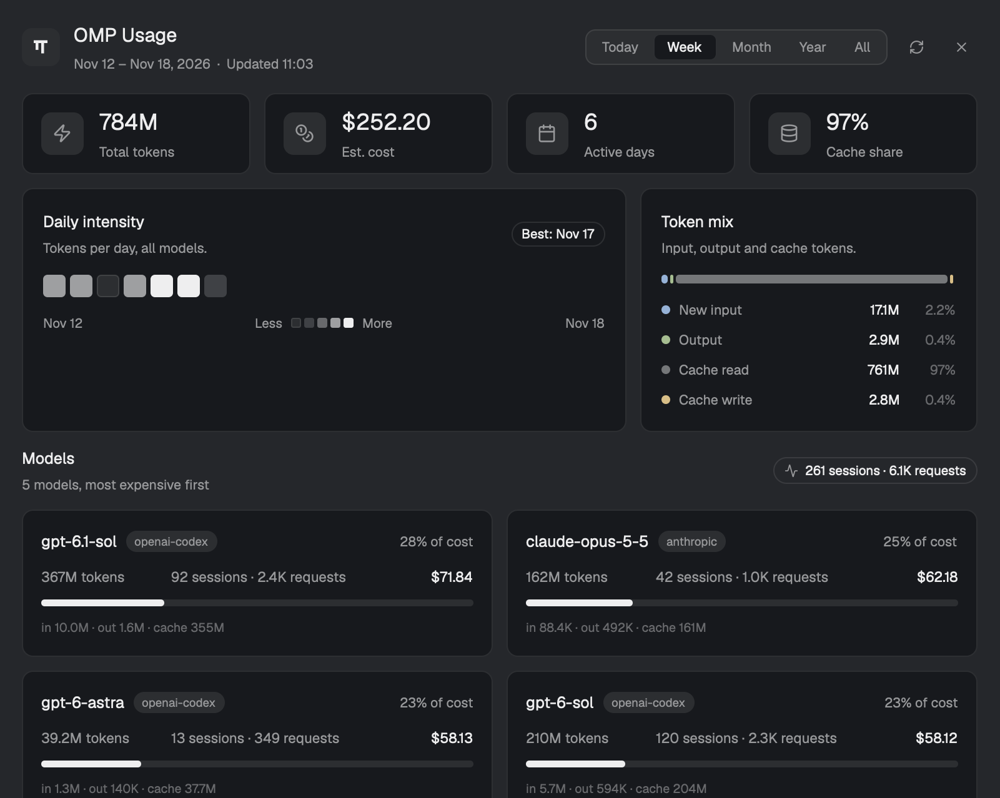

# OMP Usage

A dialog that says what omp (oh-my-pi) consumed in a date range you pick
(Today, Week, Month, Year, All): total tokens, estimated cost, how the use
spread over the days, the mix of input, output and cache tokens, and which
models it all went to, most expensive first.

## What you see

A 900 x 720 dialog on the theme's `popover` color, 24 px padding, 12 px
between blocks. Cards are `background` with a 1 px `border`, radius 10.

- **Header** (fixed): a 34 px `raised` tile with the shipped `icons/omp.svg`,
  "OMP Usage" (17 px, semibold), under it the dates covered and "Updated
  HH:MM" (12 px, `muted`; "Syncing with omp…" while it syncs). On the right a
  segmented control, Today / Week / Month / Year / All (`raised` track, the
  chosen one on `background` with a border), a refresh button whose icon
  spins while reading, and a close button.
- **Four tiles** (72 px tall, equal widths), each an icon in a 38 px `raised`
  tile, a 20 px number and a 12 px label: Total tokens, Est. cost, Active
  days (Active hours on Today), Cache share.
- **Intensity** card (takes the remaining width): "Daily intensity" ("Hourly
  intensity" on Today), a "Best: Nov 17" pill, then one square per day of the
  range (per hour on Today) in a wrapping row: 20 px squares up to 31 cells,
  14 px up to 120, 10 px beyond. Five shades: `raised` with a border for
  nothing, then `foreground` at 19%, 38%, 63% and 100%, by quarter of the
  busiest cell. Below, the first and last label and a Less / More legend.
- **Token mix** card (300 px): one 8 px bar split by share into New input
  (`ansi4`), Output (`ansi2`), Cache read (`foreground` at 44%) and Cache
  write (`ansi3`), each at least 3 px, and a legend row for each with its
  amount and percent.
- **Models**: a heading with the count, a pill with the sessions and requests
  of the range, then one card per provider and model, two per row. A card has
  the model name, the provider in a small `raised` pill, "28% of cost", then
  tokens, "92 sessions · 2.4K requests", the cost, a 6 px bar filled to its
  share, and a dim line "in 10.0M · out 1.6M · cache 355M".

The body scrolls; the header stays.

## How it behaves

- Agent statuses play no part: this mod shows usage, not agents.
- Ranges are rolling and end today: Today is since local midnight, Week the
  last 7 days, Month the last 30, Year the last 365, All everything recorded
  (its intensity starts at the first day with data). The choice is remembered.
- Clicking a range shows what was read for it before, if anything, and reads
  it again.
- Opening the dialog shows the ledger as it is, then has omp bring it up to
  date and reads again. The same happens every 2 minutes while it is open and
  when the refresh button is clicked.
- Hovering a square says its day or hour, tokens and cost; hovering a tile
  explains its number; hovering a model card gives the exact token counts;
  hovering a range says what it covers.
- Shares are of cost; when the range has no priced cost, of tokens.
- A range with no use shows zeros and "No omp usage in this range."
- If the ledger can't be read, a line in the `blocked` color says why. If omp
  can't be run, a `muted` line says the numbers may be behind, and what was
  already in the ledger still shows.
- Esc, a click beside the dialog or the close button closes it. The included
  `keys.json` opens it with cmd-alt-u.

## Built from

- `mods/omp-usage/mod.json`: `"place": "none"`, title "OMP Usage",
  `"overlay": { "kind": "dialog", "width": 900, "height": 720 }`. Opened with
  `mod.open {name: "omp-usage"}`.
- `main.js`: the view. `herdr` functions: `theme`, `props`, `closeOverlay`,
  `checking`. Its range is kept in `localStorage` under `range`.
- `data.js`: everything about the data. `herdr` functions: `exec`, `home`.
  - Reads `~/.omp/stats.db` with `sqlite3 -readonly`, one statement that
    returns one JSON object: today's date and the time, the first day in the
    range, the totals, a row per provider and model, and a row per day (per
    hour on Today). The table is `messages`: one row per model reply with
    `timestamp` (ms), `model`, `provider`, `session_file`, `input_tokens`,
    `output_tokens`, `cache_read_tokens`, `cache_write_tokens`,
    `total_tokens`, `cost_total`, `cost_unpriced`.
  - Syncs by running `omp stats --summary` and ignoring what it prints: that
    command reads new session files into the ledger before reporting.
- Widths are flex and percent only (`flex_1`, `flex_grow(share)`,
  `w("28.00%")`), so the dialog can be given another size, or the mod put in a
  pane (`tab.new {mod: "omp-usage"}`).
- Programs it runs: `sqlite3` and `omp`. No network. It reads one file outside
  its folder, `~/.omp/stats.db`, and omp writes to that file when asked to sync.
- Art: `icons/` (Lucide `zap`, `coins`, `calendar`, `database`, `activity`,
  `refresh-cw`, `x`) and the shipped `icons/omp.svg`.

## Watch out

- omp only updates `stats.db` when `omp stats` runs. Without the sync the
  numbers stop at the last time someone ran it.
- The first sync after an omp upgrade can re-read every session file: about
  20 seconds and very different totals afterwards. Later ones take well under
  a second.
- The app's PATH may lack the folder omp lives in (`~/.bun/bin` when started
  from the Dock). Try `omp`, then `~/.bun/bin`, `~/.local/bin`,
  `~/.npm-global/bin`, `/opt/homebrew/bin`, `/usr/local/bin`.
- Don't read omp's `message_rollup` or `session_rollup` tables: they are
  filled lazily and can be empty. Aggregate `messages`.
- Let sqlite compute the start of the range and the day of each row with
  `'localtime'`, and walk the days in UTC from the date it returns: the
  script's own time zone may not be the machine's.
- Don't size things in px from `on_size_change`: it reports pixels after the
  app's zoom, and bars and cards computed from it come out too narrow.
- Est. cost is omp's estimate at API prices, not what a subscription charged.
  Requests without a price count as $0; the cost tile's tooltip says how many.
- Sessions are counted per range, so a session that spans two days is one in
  Week and one in each of its days.
- `init()` returns early under `herdr-app check`, so a check never runs
  `sqlite3` or `omp` and only proves the empty state draws.
- Installed under another name, rename the `mods/omp-usage/` icon paths and
  the key's `mod.open:omp-usage`.

## Done when

- `herdr-app check mods/omp-usage` passes.
- `herdr-app do mod.open --name omp-usage` shows the dialog, and within a few
  seconds the tiles, the squares, the token mix and the model cards.
- The model costs add up to Est. cost, and the tokens of the squares to Total
  tokens.
- Each of Today, Week, Month, Year and All changes the dates in the header
  and the numbers; Today shows 24 squares, Week 7, Month 30, Year 365.
- After using omp, clicking refresh raises today's numbers.
- With `~/.omp/stats.db` moved away, the dialog says there is no omp usage
  data instead of drawing nothing.
